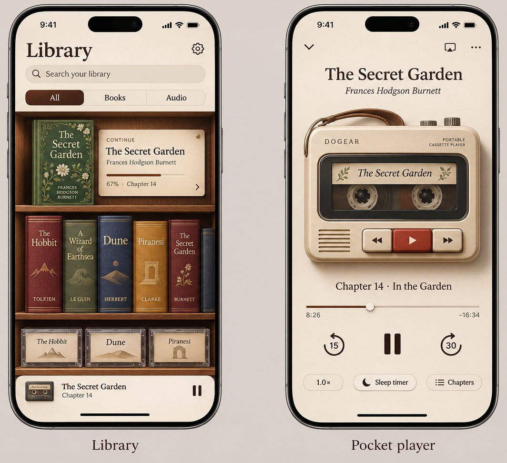

<p align="center">
  
</p>

<h1 align="center">Dogear</h1>

<p align="center">
  A native iPhone and iPad app for reading ebooks and listening to audiobooks from a self-hosted <a href="https://github.com/grimmory-tools/grimmory">Grimmory</a> server.<br>
  <a href="https://dogear.srcery.computer"><strong>dogear.srcery.computer</strong></a>
</p>

<p align="center">
  <a href="https://github.com/xchrisbailey/dogear/actions/workflows/ci.yml"></a>
  
  
</p>

<p align="center">
  
</p>

Dogear signs in to your Grimmory server, shows your library on a walnut bookshelf, and lets you read or listen with offline downloads. Your position stays in step with Grimmory's web reader in both directions, so you can start a chapter on your laptop and finish it on your phone.

> **Status:** in active development and not on the App Store yet. To try it, build it from source (see [Building](#building)).

## Features

**Reading**
- EPUB and PDF, plus MOBI, AZW3 and FB2, converted to EPUB on the device when opened ([ADR 0005](docs/adr/0005-convert-mobi-azw3-fb2-to-epub.md))
- An open-book reader with page curl, a choice of fonts, and two pages side by side on iPad or in landscape
- Contents (table of contents) jumps

**Listening**
- Single-file (M4B) and folder audiobooks, with Chapters and Tracks
- Speed from 0.75× to 3× at normal pitch, adjustable skip times, and a sleep timer (including "end of Chapter")
- Lock screen and Control Center controls, Now Playing artwork, AirPlay, and playback that continues when the player is closed
- A pocket tape player with the Book loaded as a cassette

**Progress and offline**
- Reads and writes the same Shared position as Grimmory's web reader, including EPUB CFIs, so both resume on the same page ([ADR 0004](docs/adr/0004-read-and-write-cfis.md))
- Downloads keep a Book file on the device for offline reading and listening
- Positions recorded offline wait in an Outbox and are sent when the Server is reachable; newer reading done elsewhere always wins ([ADR 0002](docs/adr/0002-newest-reading-wins.md))
- Hardcover progress is logged by Grimmory itself, so Dogear never needs a Hardcover token ([ADR 0001](docs/adr/0001-hardcover-through-grimmory.md))

**Library and connection**
- A bookcase library with a Continue shelf, cassette cases for audiobooks, Grimmory shelves, and layouts made for iPhone and iPad
- Three app themes: Walnut & Paper (default), Oak & Daylight and Bookcloth & Tape
- HTTPS, or plain HTTP to a Server on a Tailscale network, where WireGuard already encrypts the connection ([ADR 0006](docs/adr/0006-plain-http-over-tailscale.md))

## Requirements

- iPhone or iPad on **iOS 26** or later
- A **Grimmory** server and an account on it. Dogear is tested against Grimmory **3.5.0**.
- The Server reachable over HTTPS, or over HTTP on your tailnet (`*.ts.net`, a bare MagicDNS name, or a `100.64.0.0/10` address)

## Building

You need a Mac with the latest Xcode (iOS 26 SDK) and [XcodeGen](https://github.com/yonaskolb/XcodeGen). The Xcode project is generated from `project.yml` and is not committed.

```sh
git clone https://github.com/xchrisbailey/dogear.git
cd dogear
git config core.hooksPath .githooks   # pre-commit checks, once per clone

xcodegen generate                     # creates Dogear.xcodeproj
open Dogear.xcodeproj
```

To run on your own device, set your own development team and a unique bundle identifier in `project.yml` (`DEVELOPMENT_TEAM`, `bundleIdPrefix` and `PRODUCT_BUNDLE_IDENTIFIER`), then generate the project again.

Command-line builds use throwaway simulators that are always cleaned up:

```sh
scripts/app.sh build      # generate the project and build on a throwaway simulator
scripts/app.sh compile    # build the app and its tests without booting a simulator
```

## Testing

Tests are split into two seams:

| Seam | What it covers | Run it |
| --- | --- | --- |
| 1 | `DogearCore` against a fake Grimmory server, with fixtures captured from real v3.5.0 responses | `swift test --package-path Core` |
| 2 | The EPUB CFI bridge on a real Readium navigator with a fixture EPUB | `scripts/app.sh test` |

CI runs the checks in `scripts/check-*.sh`, seam 1 and a compile on every pull request, and seam 2 on `main` (or on a PR labelled `seam-2`). Audio behaviour that automated tests can't reach is covered by device checklists in [`docs/checklists/`](docs/checklists/).

## Project layout

```
App/          SwiftUI app: library, readers, audiobook player, downloads, settings
Core/         DogearCore, a UI-free Swift package: Grimmory client, Positions, Outbox, Downloads
AppTests/     Seam 2 tests and fixtures
docs/adr/        Architecture decision records
docs/checklists/ Device checklists for releases
docs/reference/  Notes on the Grimmory API, Readium and AVFoundation
scripts/      Build, test, simulator, TestFlight and guardrail scripts
site/         The landing page at dogear.srcery.computer
```

Shared vocabulary (Book, Book file, Position, Shared position, Outbox and so on) is defined in [`GLOSSARY.md`](GLOSSARY.md). Review standards are in [`CODING_STANDARDS.md`](CODING_STANDARDS.md).

## Landing page

[dogear.srcery.computer](https://dogear.srcery.computer) is a static page in `site/`, published to GitHub Pages by [`.github/workflows/pages.yml`](.github/workflows/pages.yml) on every push to `main` that touches it.

## Acknowledgements

- [Grimmory](https://github.com/grimmory-tools/grimmory), the self-hosted library Dogear is built for
- [Readium Swift Toolkit](https://github.com/readium/swift-toolkit) for EPUB and PDF rendering
- [foliate-js](https://github.com/johnfactotum/foliate-js) (MIT) for EPUB CFIs and the MOBI, AZW3 and FB2 conversion

Dogear is an independent project and isn't affiliated with Grimmory or Hardcover.
